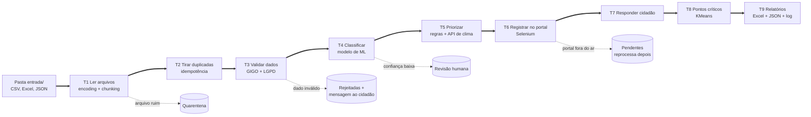

# ZelaBot: robô de zeladoria urbana com RPA + IA

**Global Solution 2026.2 | AI for Robotic Process Automation (RPA + IA)**

O ZelaBot é um robô que recebe as reclamações de zeladoria dos moradores (buraco, poste apagado, lixo, bueiro entupido, árvore com risco de cair), entende o que cada uma pede, decide a prioridade, registra tudo no sistema da prefeitura com um protocolo e devolve uma resposta para o cidadão. O que ele não tem certeza, ele não chuta: manda para uma pessoa revisar.

## Integrantes

| Nome | RM |
| :- | :- |
| (preencher) | (preencher) |
| (preencher) | (preencher) |
| (preencher) | (preencher) |

## O problema

Quem mora numa cidade grande conhece a história: você reclama do buraco pelo app, o vizinho reclama do mesmo buraco pelo totem, a subprefeitura manda uma planilha, e alguém da prefeitura precisa ler tudo isso, entender do que se trata, descobrir para qual setor mandar, decidir o que é urgente e digitar uma por uma num sistema antigo. Esse trabalho manual é lento, repetitivo e cheio de chance de erro. O resultado aparece para o cidadão como demora e falta de resposta, e o pior caso é quando algo perigoso (um fio soltando faísca, uma árvore prestes a cair perto de uma escola) fica na fila junto com um saco de lixo.

**Público afetado:** moradores que usam os canais de zeladoria (principalmente de bairros periféricos, onde os problemas costumam se acumular) e os servidores da triagem, que hoje gastam o dia copiando e colando.

**O que o protótipo faz:** automatiza a triagem e o registro de ponta a ponta, deixando o servidor livre para os casos que realmente precisam de julgamento humano.

## Como o robô funciona



As linhas pontilhadas são os **caminhos seguros**: cada tipo de problema vai para uma fila própria, com o motivo registrado, e o restante continua rodando. Nada para a execução inteira.

O "sistema da prefeitura" é um **portal web simulado** que fizemos (pasta `portal/`), com login e formulário, para o robô ter onde trabalhar de verdade. Ele roda localmente e sobe junto com o robô.

## Quadro de temas

Usamos 6 temas da disciplina, cada um fazendo uma parte real do fluxo. O detalhamento, com a justificativa de cada escolha e os temas que decidimos **não** usar, está em [docs/quadro_de_temas.md](docs/quadro_de_temas.md).

| Tema | Onde foi usado no fluxo | O que resolve |
| :- | :- | :- |
| **1. Automação web com Selenium** | T6, [src/rpa_portal.py](src/rpa_portal.py) | Faz login no portal e cadastra cada solicitação como um servidor faria, com espera explícita, retry e print da tela quando dá erro. Elimina a digitação manual. |
| **2. Arquivos e I/O** (encoding, chunking, modos de abertura, monitoramento de pasta com watchdog) | T1, [src/leitura.py](src/leitura.py) e modo `vigiar` do [main.py](main.py) | Lê o que cada canal manda do seu jeito: CSV em UTF-8, CSV antigo em CP1252 com `;`, Excel e JSON. Arquivo quebrado vai para quarentena. No modo vigia, processa sozinho cada arquivo que chega. |
| **3. Automação de Excel** (pandas + calamine para ler, XlsxWriter para escrever) | T1 e T9, [src/relatorio.py](src/relatorio.py) | Lê a planilha da subprefeitura e gera a planilha final para a equipe, com abas por situação, cores por prioridade, filtros e gráfico. |
| **4. Tratamento de erros e logs** | Todo o fluxo, [src/resiliencia.py](src/resiliencia.py) e [src/logs.py](src/logs.py) | Retry com espera exponencial, timeout, disjuntor, fila de pendentes, quarentena, idempotência e log de cada passo. O robô não cai por causa de uma falha previsível. |
| **5. HyperAutomation: RPA + IA/ML** (classificador, balanceamento, KMeans) | T4 e T8, [src/modelo.py](src/modelo.py) | O classificador entende o texto livre do cidadão; o limiar de confiança decide quando chamar um humano; o KMeans acha pontos críticos para a prefeitura planejar mutirões. |
| **6. BPM: processo, tarefa e relação + qualidade de dados (GIGO)** | Estrutura do [src/pipeline.py](src/pipeline.py) e T3, [src/validacao.py](src/validacao.py) | Mapeamos o processo AS-IS e desenhamos o TO-BE ([docs/processo_as_is_to_be.md](docs/processo_as_is_to_be.md)); o código segue esse desenho, tarefa por tarefa. A validação barra dado ruim antes da IA, porque lixo entra, lixo sai. |

Complemento: o **psutil** mede memória e CPU de cada execução e isso vai para o relatório de execução.

## Como executar

**Pré-requisitos:** Python 3.10 ou mais novo e Google Chrome instalado. Na primeira execução o Selenium baixa sozinho o driver do Chrome (precisa de internet).

1) Clonar o repositório e entrar na pasta:

```bash
git clone <url-do-repositorio>
```

```bash
cd zelabot
```

2) Criar e ativar um ambiente virtual (Windows):

```bash
python -m venv .venv
```

```bash
.venv\Scripts\activate
```

No Linux ou Mac, a ativação é `source .venv/bin/activate`.

3) Instalar as dependências:

```bash
pip install -r requirements.txt
```

4) Criar o arquivo de configuração a partir do modelo (no Linux ou Mac, use `cp` no lugar de `copy`) e definir uma senha para o portal dentro dele:

```bash
copy .env.example .env
```

5) Rodar o robô:

```bash
python main.py
```

Pronto. O robô sobe o portal simulado, processa os 5 arquivos de exemplo da pasta `entrada/` e gera a planilha e o relatório em `saida/relatorios/`. Leva uns 20 segundos.

### Outros comandos

| Comando | O que faz |
| :- | :- |
| `python main.py` | Execução completa, do início ao fim |
| `python main.py vigiar` | Fica vigiando a pasta `entrada/` e processa cada arquivo novo sozinho (execução sem intervenção) |
| `python main.py avaliar` | Mede o modelo no conjunto de teste rotulado e salva os resultados em `docs/evidencias/` |
| `python main.py falhas` | Roda 8 cenários de falha de propósito e confere se o robô seguiu o caminho seguro |
| `python main.py treinar` | Retreina o classificador |
| `python main.py reset` | Apaga estado e saídas para rodar do zero (a pasta `entrada/` é mantida) |
| `python -m pytest` | Roda os 19 testes automatizados |

Dica para apresentação: colocando `NAVEGADOR_VISIVEL=1` no `.env`, dá para ver o Chrome preenchendo o portal sozinho.

## Como configurar as chaves

Nenhuma senha ou chave fica no código. Tudo vem do arquivo `.env`, que está no `.gitignore` e **nunca vai para o repositório**. O arquivo `.env.example` mostra o formato:

| Variável | Para que serve |
| :- | :- |
| `PORTAL_USUARIO` / `PORTAL_SENHA` | Login do robô no portal da prefeitura. O portal simulado aceita o que estiver aqui. |
| `PSEUDONIMO_SAL` | Texto secreto usado para gerar o pseudônimo do cidadão (sem ele não dá para "desfazer" o pseudônimo testando nomes). |
| `CLIMA_API_URL` | API pública Open-Meteo. É gratuita e **não precisa de chave**. |
| `LIMIAR_CONFIANCA` | Abaixo desse valor o robô manda para revisão humana (padrão 0,55, explicamos a escolha nas evidências). |
| `TIMEOUT_SEGUNDOS`, `MAX_TENTATIVAS`, `ESPERA_INICIAL` | Controle de timeout e retry. |
| `CHROMEDRIVER_PATH` | Opcional. Caminho de um chromedriver já instalado, para máquinas sem internet ou que bloqueiam download. |

Não usamos LLM, então não existe chave de API paga no projeto.

## O que o robô entrega

Cada execução gera em `saida/`:

- `relatorios/relatorio_<data>.xlsx`: planilha com as abas **Resumo** (indicadores e gráfico), **Registradas** (com protocolo, prioridade, justificativa e mensagem ao cidadão), **Revisão humana** (urgentes primeiro), **Rejeitadas**, **Pendentes**, **Pontos críticos** e **Arquivos lidos**;
- `relatorios/execucao_<data>.json`: relatório de execução completo (o que entrou, o que saiu, tempo, memória);
- `logs/zelabot_<data>.log`: log de cada passo;
- `quarentena/`: arquivos que não puderam ser lidos, com um `.motivo.txt` ao lado;
- `prints/`: telas capturadas pelo Selenium.

Um exemplo de cada um já está em [docs/evidencias/](docs/evidencias/), para quem quiser ver sem rodar.

## Evidências de validação

Resumo (detalhes, análise dos erros e limites em [docs/evidencias_validacao.md](docs/evidencias_validacao.md)):

- **Execução de ponta a ponta** com 5 arquivos e 31 registros: 23 registradas no portal com protocolo, 4 para revisão humana, 3 rejeitadas com motivo, 1 duplicata ignorada e 1 arquivo corrompido em quarentena. Conferimos uma a uma: as 23 registradas foram classificadas na categoria certa.
- **Conjunto de teste rotulado** (59 frases escritas à mão, separadas do treino): o modelo acertou **86,3%** das 51 frases do escopo (F1 macro 0,861), contra **70,6%** de uma regra simples por palavra-chave. Com o limiar de confiança, o robô automatiza **71%** dos casos e acerta **92,9%** do que automatiza; 7 dos 8 pedidos fora do escopo foram parar na revisão humana.
- **Regra de urgência:** pegou 13 dos 14 casos de risco (recall 0,93).
- **Falhas tratadas:** 8 de 8 cenários passaram ([docs/evidencias/demo_falhas.md](docs/evidencias/demo_falhas.md)), incluindo API fora do ar, portal fora do ar, portal instável com erro 503, senha errada, arquivo corrompido, arquivo ausente, dado inválido e execução repetida.

## Proteção de dados, ética e ODS

O protótipo usa apenas dados sintéticos, e mesmo assim foi construído como se os dados fossem reais: o nome do cidadão vira um pseudônimo, CPF, telefone e e-mail digitados no texto são mascarados antes de chegar ao modelo, ao portal ou ao relatório, e a única informação enviada para fora (API de clima) é o centro do bairro, nunca o endereço da pessoa. A IA não toma decisões escondidas: toda prioridade vem com uma justificativa em texto, o que tem baixa confiança vai para um humano e nenhum pedido é negado sem uma mensagem explicando o que faltou. Reconhecemos um risco importante: o robô só enxerga quem reclama, e bairros com menos acesso digital podem parecer "sem problemas" no mapa de pontos críticos. A solução se conecta ao **ODS 11** (cidades mais seguras, incluindo prevenção de alagamentos), ao **ODS 16** (instituições mais eficazes e transparentes) e ao **ODS 10** (redução de desigualdades, desde que esse viés seja acompanhado). Análise completa em [docs/dados_etica_ods.md](docs/dados_etica_ods.md).

## Limites e próximos passos

- A base de treino é sintética e pequena. O próximo passo seria treinar com reclamações reais anonimizadas (existem bases públicas de canais de atendimento).
- O limiar de 0,55 foi escolhido olhando o próprio conjunto de teste, então o número real em produção tende a ser um pouco pior. O certo seria separar um conjunto de validação.
- O portal é simulado. Num sistema real, os seletores do Selenium precisariam ser ajustados, e o ideal seria usar uma API do sistema quando ela existir.
- Os logs que o robô gera já têm o formato de eventos (quem, o quê, quando), o que permitiria aplicar mineração de processos para achar gargalos no futuro.

## Estrutura do repositório

```
zelabot/
├── main.py                  ponto de entrada (todos os comandos)
├── src/
│   ├── pipeline.py          orquestra o processo T1 a T9
│   ├── leitura.py           tema Arquivos e I/O
│   ├── validacao.py         GIGO + LGPD
│   ├── modelo.py            classificador + KMeans
│   ├── prioridade.py        regras inteligentes + API de clima
│   ├── rpa_portal.py        robô Selenium
│   ├── relatorio.py         planilha (XlsxWriter) + JSON
│   ├── resiliencia.py       retry, idempotência, estado
│   ├── logs.py              configuração de logs
│   ├── avaliacao.py         métricas no conjunto de teste
│   ├── demo_falhas.py       demonstração automática das falhas
│   └── config.py            leitura do .env
├── portal/servidor.py       portal da prefeitura simulado
├── dados/
│   ├── gerar_dados.py       gera os dados sintéticos
│   ├── treino/              base de treino (sintética)
│   └── teste/               conjunto de teste rotulado (escrito à mão)
├── entrada/                 arquivos de exemplo que o robô processa
├── tests/                   testes automatizados (pytest)
├── docs/                    quadro de temas, processo, evidências, ética
├── .env.example             modelo de configuração (sem segredos)
└── requirements.txt
```
