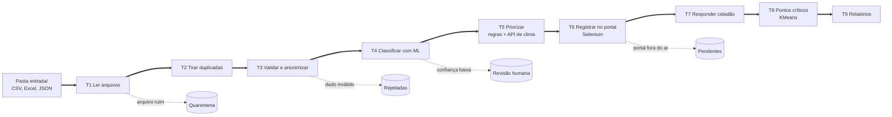

# ZelaBot: robô de zeladoria urbana com RPA + IA

**Global Solution 2026.2 | AI for Robotic Process Automation**

Robô que recebe reclamações de zeladoria (buraco, poste apagado, lixo, bueiro entupido, árvore com risco), classifica cada uma com IA, define a prioridade, registra no sistema da prefeitura com protocolo e responde o cidadão. Quando não tem certeza, encaminha para revisão humana.

## Integrantes

| Nome | RM |
| :- | :- |
| Claudio Alves | RM568565 |
| Gustavo Duarte | RM567066 |
| Leonardo Pereira | RM567836 |

## O problema

Reclamações chegam por app, totem, site e planilhas da subprefeitura, cada canal num formato. Um servidor lê tudo, decide categoria e urgência no olho e digita uma por uma num sistema antigo. O resultado é demora, falta de resposta e casos perigosos (fio soltando faísca, árvore prestes a cair perto de escola) na mesma fila de um saco de lixo.

**Público:** moradores que usam os canais de zeladoria, em especial de bairros periféricos, e os servidores da triagem.

## Como funciona



As linhas pontilhadas são os caminhos seguros: cada falha vai para uma fila própria, com o motivo registrado, e o restante segue. O sistema da prefeitura é um portal web simulado (`portal/`), com login e formulário, que sobe junto com o robô.

## Quadro de temas

Detalhamento e temas descartados em [docs/quadro_de_temas.md](docs/quadro_de_temas.md).

| Tema | Onde no fluxo | O que resolve | Por que escolhemos |
| :- | :- | :- | :- |
| **1. Automação web com Selenium** | T6, [src/rpa_portal.py](src/rpa_portal.py) | Faz login no portal e cadastra cada solicitação, com espera explícita, retry e print da tela em caso de erro. | Sistemas públicos antigos raramente têm API. Selenium localiza os campos pela página, sem depender de coordenadas da tela como o PyAutoGUI. |
| **2. Arquivos e I/O** (encoding, chunking, modos de abertura, watchdog) | T1, [src/leitura.py](src/leitura.py) e modo `vigiar` | Lê CSV em UTF-8 e em CP1252, Excel e JSON; arquivo corrompido vai para quarentena; o modo vigia processa cada arquivo novo sozinho. | Cada canal grava num formato e encoding diferente. Sem esse tratamento, "Calçada" vira "Calçada" ou a leitura quebra. |
| **3. Automação de Excel** (pandas + calamine, XlsxWriter) | T1 e T9, [src/relatorio.py](src/relatorio.py) | Lê a planilha da subprefeitura e gera o relatório da equipe, com abas por situação, cores por prioridade, filtros e gráfico. | A prefeitura trabalha com Excel. Calamine lê rápido e XlsxWriter permite formatação e gráficos. |
| **4. Tratamento de erros e logs** | Todo o fluxo, [src/resiliencia.py](src/resiliencia.py) | Timeout, retry com espera exponencial, disjuntor, pendentes, quarentena, idempotência e log de cada tarefa. | API, portal e arquivos falham na prática; cada falha previsível precisa de um caminho seguro. |
| **5. RPA + IA/ML** (classificador, balanceamento, KMeans) | T4 e T8, [src/modelo.py](src/modelo.py) | Classifica o texto livre do cidadão com nível de confiança; abaixo do limiar, encaminha para revisão humana. KMeans aponta pontos críticos. | Regra por palavra-chave não entende linguagem natural: o ML acertou 86,3% contra 70,6% da regra. Sem LLM, o texto do cidadão não sai da máquina. |
| **6. BPM + qualidade de dados (GIGO)** | [src/pipeline.py](src/pipeline.py) e T3, [src/validacao.py](src/validacao.py) | O processo AS-IS/TO-BE ([docs/processo_as_is_to_be.md](docs/processo_as_is_to_be.md)) define as tarefas e a ordem do código. A validação barra dado ruim antes da IA. | O mapeamento separa o que é repetitivo (robô) do que exige julgamento (pessoa). Dado ruim gera resultado ruim. |

**Como se combinam:** o watchdog detecta o arquivo, o I/O o lê corretamente, a validação garante que só dado bom chega ao modelo, a categoria prevista alimenta as regras de prioridade e só então o Selenium registra no portal. O Excel consolida o resultado, o tratamento de erros envolve todas as etapas e o BPM define a ordem. O psutil registra memória e CPU de cada execução.

## Como executar

Requisitos: Python 3.10+ e Google Chrome. Na primeira execução o Selenium baixa o driver do Chrome (requer internet).

```bash
python -m venv .venv
```

```bash
.venv\Scripts\activate
```

No Linux/Mac: `source .venv/bin/activate`.

```bash
pip install -r requirements.txt
```

```bash
copy .env.example .env
```

No Linux/Mac: `cp .env.example .env`.

```bash
python main.py
```

Resultado esperado ao final do log:

```
FIM: 31 lidos | 23 registradas | 4 revisao humana | 3 rejeitadas | 0 pendentes | 1 quarentena | 0 ja processadas
```

| Comando | Função |
| :- | :- |
| `python main.py` | Execução completa |
| `python main.py vigiar` | Processa automaticamente cada arquivo novo em `entrada/` |
| `python main.py avaliar` | Métricas no teste rotulado e no lote de entrada com gabarito |
| `python main.py falhas` | Executa 9 cenários de falha e confere o caminho seguro |
| `python main.py reset` | Apaga estado e saídas para rodar do zero |
| `python -m pytest` | 20 testes automatizados |

Ao rodar de novo sem `reset`, o robô mostra `0 registradas`: é a idempotência, que impede cadastro em dobro. Se o Chrome não abrir, as solicitações ficam em pendentes e são registradas na execução seguinte.

## Configuração (.env)

Nenhuma senha fica no código. O `.env` está no `.gitignore`; o modelo é o [.env.example](.env.example).

| Variável | Função |
| :- | :- |
| `PORTAL_USUARIO` / `PORTAL_SENHA` | Login do robô no portal |
| `PSEUDONIMO_SAL` | Segredo usado para pseudonimizar o cidadão |
| `CLIMA_API_URL` | API pública Open-Meteo, gratuita e sem chave |
| `LIMIAR_CONFIANCA` | Abaixo dele, a decisão vai para revisão humana (padrão 0,55) |
| `TIMEOUT_SEGUNDOS`, `MAX_TENTATIVAS`, `ESPERA_INICIAL` | Timeout e retry |
| `CHROMEDRIVER_PATH` | Opcional: driver já instalado, para máquinas sem internet |
| `NAVEGADOR_VISIVEL` | `1` mostra o Chrome preenchendo o portal |

## Saídas

Em `saida/`, a cada execução: planilha (`relatorios/relatorio_<data>.xlsx`), relatório de execução em JSON, log, quarentena com o motivo de cada arquivo e prints do Selenium. Exemplos em [docs/evidencias/](docs/evidencias/).

## Evidências

Detalhes em [docs/evidencias_validacao.md](docs/evidencias_validacao.md).

- **Ponta a ponta:** 31 registros em 5 arquivos geram 23 registros no portal, 4 revisões humanas, 3 rejeições com motivo, 1 duplicata ignorada e 1 arquivo em quarentena.
- **Lote de entrada com gabarito:** 23/23 automatizadas na categoria certa (IC 95%: 85,7% a 100%), 3/3 rejeições corretas, 2/2 casos fora do escopo em revisão, 0 erros silenciosos.
- **Teste rotulado (59 frases):** 86,3% de acurácia (IC 95%: 74,3% a 93,2%) contra 70,6% da regra por palavra-chave. Com o limiar, o robô automatiza 71% e acerta 92,9% do que automatiza.
- **Falhas:** 9 de 9 cenários tratados ([docs/evidencias/demo_falhas.md](docs/evidencias/demo_falhas.md)).

## Proteção de dados, ética e ODS

Os dados são sintéticos, mas o robô trata como reais: o nome vira pseudônimo, CPF, telefone e e-mail no texto são mascarados antes de qualquer etapa, e só o centro do bairro é enviado à API de clima. Toda prioridade vem com justificativa, baixa confiança vai para uma pessoa e nenhum pedido é rejeitado sem explicação ao cidadão. O principal risco é o viés de participação: o robô só vê quem reclama, e bairros com menos acesso digital podem parecer sem problemas. Contribui com os **ODS 11** (cidades seguras, prevenção de alagamentos), **16** (instituições eficazes e transparentes) e **10** (redução de desigualdades, se o viés for monitorado). Análise completa em [docs/dados_etica_ods.md](docs/dados_etica_ods.md).

## Limites

- Base de treino sintética e amostras pequenas; os intervalos de confiança são largos.
- O limiar de 0,55 foi escolhido no próprio conjunto de teste; o desempenho real tende a ser um pouco menor.
- Pontos críticos do KMeans não foram validados contra vistorias.
- Portal simulado: num sistema real, os seletores do Selenium precisariam de ajuste.

## Estrutura

```
zelabot/
├── main.py                  ponto de entrada
├── src/                     pipeline, leitura, validação, modelo, prioridade,
│                            Selenium, relatório, resiliência, avaliação
├── portal/servidor.py       portal da prefeitura simulado
├── dados/                   gerador sintético, treino, teste rotulado e gabarito
├── entrada/                 lotes de exemplo
├── tests/                   testes (pytest)
├── docs/                    temas, processo, evidências, ética
└── .env.example             modelo de configuração
```
