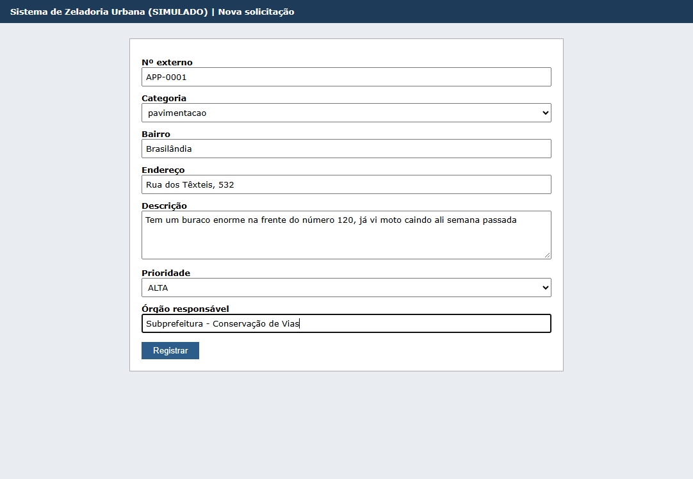
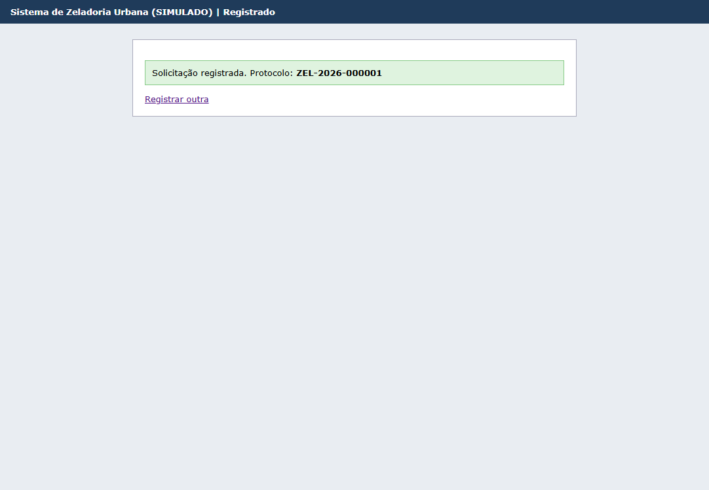
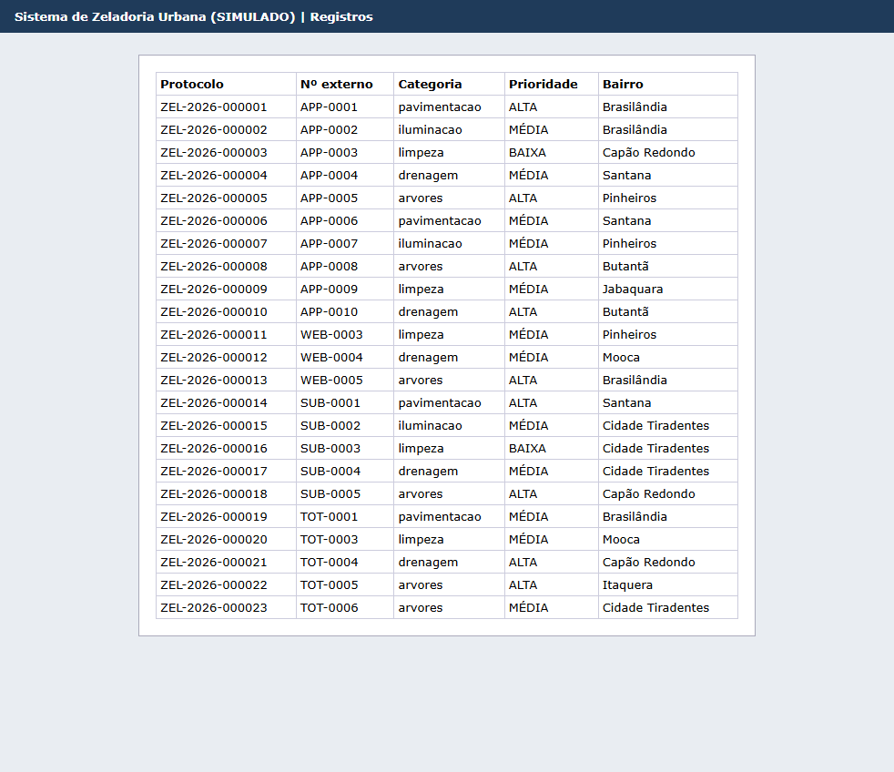
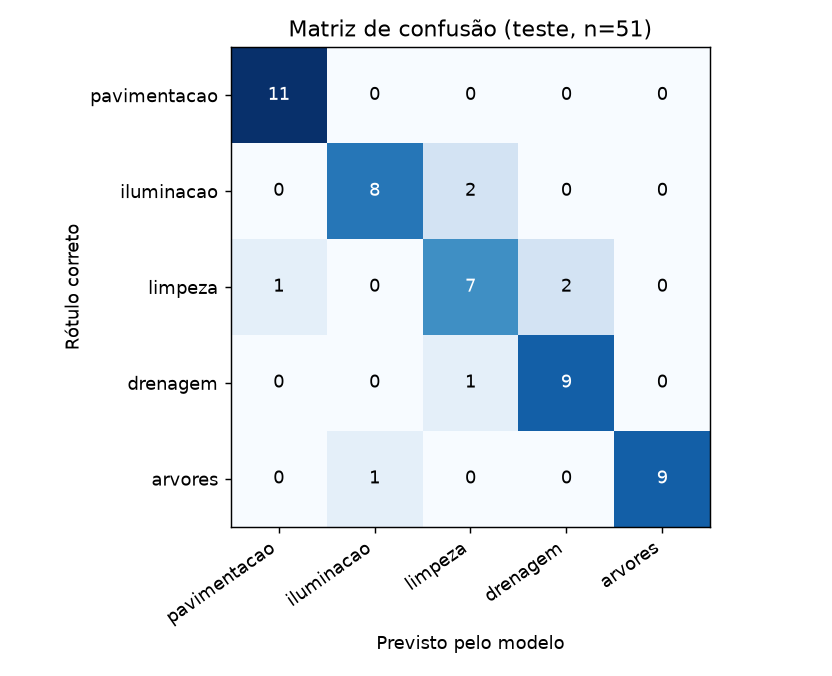

# Evidências de validação

Tudo aqui pode ser reproduzido com os comandos indicados. Os arquivos citados estão em [docs/evidencias/](evidencias/).

Separamos a validação em três partes: **(1)** o robô rodando de ponta a ponta com dados de teste, **(2)** a medição do modelo num conjunto rotulado e **(3)** os casos de falha.

## 1. Execução de ponta a ponta

**Comando:** `python main.py reset` e depois `python main.py`

**Entrada:** 5 arquivos na pasta `entrada/`, gerados por [dados/gerar_dados.py](../dados/gerar_dados.py), cada um num formato e com problemas colocados de propósito:

| Arquivo | Formato | Registros | Problemas colocados de propósito |
| :- | :- | :- | :- |
| `app156_2026-11-03.csv` | CSV, UTF-8, vírgula | 12 | 1 linha duplicada, 1 com bairro inexistente e coordenada "abc", 1 com telefone no texto |
| `totem_legado.csv` | CSV, **CP1252**, ponto e vírgula | 7 | 1 com data em 2031, 1 com descrição "oi" |
| `subprefeitura_lote.xlsx` | Excel | 7 | 2 pedidos fora do escopo (barulho de vizinho, semáforo) |
| `formulario_site.json` | JSON | 5 | 1 com CPF no texto, 1 caso urgente (fio soltando faísca) |
| `exportacao_interrompida.json` | JSON | ilegível | arquivo cortado no meio |

**Resultado** (log em [log_execucao_limpa.txt](evidencias/log_execucao_limpa.txt), relatório em [execucao_exemplo.json](evidencias/execucao_exemplo.json) e planilha em [relatorio_exemplo.xlsx](evidencias/relatorio_exemplo.xlsx)):

| Indicador | Valor |
| :- | :- |
| Registros lidos | 31 |
| Duplicata ignorada | 1 |
| Rejeitados por dado inválido | 3 (bairro inexistente, data no futuro, descrição curta) |
| Enviados para revisão humana | 4 |
| Registrados no portal com protocolo | 23 |
| Pendentes | 0 |
| Arquivo em quarentena | 1 |
| Dados pessoais mascarados | 2 (1 telefone, 1 CPF) |
| Tempo total | 25,2 s (inclui abrir o Chrome e consultar a API de clima) |

**Comparação com gabarito rotulado.** Para não depender de conferência no olho, rotulamos os 30 registros únicos do lote em [dados/teste/gabarito_entrada.csv](../dados/teste/gabarito_entrada.csv), dizendo para cada um o que o robô **deveria** fazer (processar, rejeitar ou mandar para revisão), a categoria certa e se é urgente. O gabarito foi feito pelo nosso julgamento, sem olhar o que o robô respondia. O comando `python main.py avaliar` compara as decisões do robô com o gabarito (detalhe por registro em [avaliacao_lote_entrada.csv](evidencias/avaliacao_lote_entrada.csv)):

| Medida | Resultado |
| :- | :- |
| Rejeições corretas | 3 de 3 |
| Pedidos fora do escopo mandados para revisão | 2 de 2 |
| Automatizadas com a categoria certa | **23 de 23** (intervalo de 95%: 85,7% a 100%) |
| Erros silenciosos (decidiu sozinho e errou) | 0 |
| Pedidos do escopo mandados para revisão sem necessidade | 2 |
| Casos urgentes detectados | 8 de 10 |

Os 2 pedidos do escopo que foram para revisão tinham confiança baixa: "Rua inteira esburacada, o ônibus nem quer mais entrar" (sugestão certa, 48%) e "Poste com fio solto soltando faísca" (sugestão certa, 34%). Esta última foi marcada como **URGENTE** e aparece no topo da aba de revisão, então mesmo sem decidir a categoria o robô não deixou o risco passar despercebido.

**Por que mostrar o intervalo de 95%?** Acertar 23 de 23 não quer dizer que o robô acerta 100% sempre. Com só 23 casos, o intervalo de Wilson mostra que a taxa real pode estar em qualquer lugar entre 85,7% e 100%. Usamos Wilson porque ele funciona bem com amostras pequenas e taxas perto de 100% (o bootstrap, que testamos antes, devolvia [100%, 100%], o que esconderia a incerteza).

Prioridades atribuídas: 9 ALTA, 12 MÉDIA e 2 BAIXA. Na urgência, o robô perdeu "galhos encostando na fiação" (TOT-0006) e "sinal de trânsito com defeito" (SUB-0007, que de qualquer forma foi para revisão por ser fora do escopo), e deu alarme a mais em "poda em frente ao posto de saúde" (WEB-0005) e "raiz levantou a calçada, cadeirante não passa" (TOT-0005). Isso está discutido nos limites (seção 5).

**Prints do Selenium trabalhando:**

| Formulário preenchido pelo robô | Protocolo gerado | Registros no portal |
| :-: | :-: | :-: |
|  |  |  |

## 2. Medição do modelo em conjunto de teste rotulado

**Comando:** `python main.py avaliar`

**Amostra:** [dados/teste/teste_rotulado.csv](../dados/teste/teste_rotulado.csv), com **59 frases escritas à mão** pelo grupo, com outro vocabulário e outro jeito de escrever em relação à base de treino (que foi gerada por templates). São 51 frases do escopo (10 ou 11 por categoria) e 8 fora do escopo. Cada frase também tem um rótulo de "urgente ou não".

> Por que escrever o teste à mão? Na validação cruzada dentro da base de treino o modelo tirou **F1 = 1,00**. Isso não quer dizer que ele é perfeito: quer dizer que as frases de treino são parecidas demais entre si. Só um teste com frases diferentes mostra o desempenho de verdade.

### 2.1 Classificador sozinho (51 frases do escopo)

| | Acurácia | F1 macro |
| :- | :-: | :-: |
| **Modelo de ML (TF-IDF + Regressão Logística)** | **86,3%** (intervalo de 95%: 74,3% a 93,2%) | **0,861** |
| Linha de base: regra por palavra-chave | 70,6% | 0,795 |

O intervalo é largo porque são só 51 frases. Mesmo no pior cenário do intervalo, o modelo fica perto da linha de base, e no cenário típico fica bem acima dela.

A regra de palavra-chave não soube responder **13 das 51 frases**, porque nenhuma palavra da lista aparecia. Exemplos: "Tem um buracão na descida" ("buracão" não é "buraco"), "As luminárias da passarela estão todas apagadas", "Largaram um colchão e um guarda-roupa velho", "Sarjeta cheia de areia e a água não corre" e "Tronco rachado depois do vendaval". O modelo de ML acertou **12 dessas 13**, porque aprende pedaços de palavras e o contexto, em vez de depender de uma lista fechada. É aí que o ML se paga.

| Categoria | Precisão | Recall | F1 | n |
| :- | :-: | :-: | :-: | :-: |
| pavimentação | 0,92 | 1,00 | 0,96 | 11 |
| iluminação | 0,89 | 0,80 | 0,84 | 10 |
| limpeza | 0,70 | 0,70 | 0,70 | 10 |
| drenagem | 0,82 | 0,90 | 0,86 | 10 |
| árvores | 1,00 | 0,90 | 0,95 | 10 |

### 2.2 O robô completo, com o limiar de confiança (59 frases)

O que importa para o cidadão não é só a acurácia, e sim **quantos erros passam sem ninguém ver**. Por isso medimos o robô com o limiar, variando o valor:

| Limiar | Automatiza | Acerto no que automatiza | Erros silenciosos | Fora do escopo pegos |
| :-: | :-: | :-: | :-: | :-: |
| 0,30 | 96,6% | 77,2% | 13 | 2/8 |
| 0,40 | 89,8% | 81,1% | 10 | 4/8 |
| 0,50 | 79,7% | 85,1% | 7 | 5/8 |
| **0,55** | **71,2%** | **92,9%** | **3** | **7/8** |
| 0,65 | 64,4% | 100% | 0 | 8/8 |
| 0,70 | 55,9% | 100% | 0 | 8/8 |

"Erro silencioso" é quando o robô decide sozinho e erra. É o pior tipo de erro, porque ninguém revisa.

Com 0,55, o acerto no que é automatizado (92,9%, 39 de 42) tem intervalo de 95% entre 81,0% e 97,5%.

**Escolhemos 0,55** porque é onde o número de erros silenciosos cai de 7 para 3 e o robô passa a segurar 7 dos 8 pedidos fora do escopo, ainda automatizando 7 em cada 10 casos. Subir para 0,65 zera os erros, mas manda mais 6 acertos para a fila humana. É uma troca: mais limiar, menos erro e mais trabalho para o servidor. **Atenção:** escolhemos o limiar olhando este mesmo conjunto, então o resultado real tende a ser um pouco pior (ver limites).

### 2.3 Regra de urgência

| Recall | Precisão | Urgentes reais |
| :-: | :-: | :-: |
| 0,93 (13 de 14) | 0,81 (13 de 16) | 14 |

Priorizamos o **recall**: deixar passar um caso de risco é muito pior que dar um alarme a mais. O único urgente perdido foi "Semáforo do cruzamento está desligado", que é fora do escopo e foi para a revisão humana de qualquer jeito.

## 3. Casos de falha tratados

**Comando:** `python main.py falhas`. O script quebra uma coisa de cada vez, roda o robô e confere se ele fez o esperado. Resultado gerado automaticamente em [demo_falhas.md](evidencias/demo_falhas.md):

| Cenário | Falha simulada | Obtido | Passou? |
| :- | :- | :- | :-: |
| API de clima fora do ar | URL apontando para host inexistente | 11 de 11 casos de bueiro/árvore com "previsão indisponível" na justificativa; disjuntor aberto após 2 falhas | sim |
| Portal fora do ar | portal desligado | 0 registradas, 23 na fila de pendentes | sim |
| Arquivo corrompido | JSON cortado no meio | quarentena com motivo; os outros 31 registros lidos | sim |
| Dados inválidos | data no futuro, "oi", bairro inexistente, duplicata | 3 rejeitadas com motivo e mensagem; duplicata ignorada | sim |
| Portal instável | erro 503 a cada 4 cadastros | 23/23 registradas depois de 7 novas tentativas automáticas; fila zerada | sim |
| Execução repetida | rodar de novo com os mesmos arquivos | 31 ignoradas; portal continuou com 23 registros (nada em dobro) | sim |
| Senha errada | `PORTAL_SENHA` inválida | 2 pendentes; após corrigir a senha, 2 registradas | sim |
| Reenvio de pedido rejeitado | cidadão reenvia o TOT-0007 ("oi") com a descrição completa | reenvio reconhecido e registrado com protocolo; o arquivo original, sem mudança, não gera rejeição repetida | sim |
| Arquivo ausente | caminho inexistente | registrado no log e execução concluída | sim |

Além disso, `python -m pytest` roda **20 testes automatizados** (validação, máscara de dados pessoais, leitura em CP1252, JSON corrompido, retry, prioridade com chuva forte e com API fora do ar, arquivo de estado travado, reenvio corrigido), todos passando. Os mesmos testes rodam sozinhos no GitHub Actions a cada push ([.github/workflows/testes.yml](../.github/workflows/testes.yml)).

**Três problemas reais que apareceram no desenvolvimento:**

1. Na primeira execução o Chrome não abriu (o driver não foi encontrado). O robô não caiu: mandou as 23 solicitações para a fila de pendentes, e na execução seguinte, com o driver resolvido, registrou todas sem duplicar nada. Foi a melhor prova de que a fila de pendentes funciona.
2. Quando levamos o projeto para uma pasta sincronizada pelo OneDrive, a demonstração de falhas parou com `PermissionError: Acesso negado` ao salvar `estado/pendentes.json`. O OneDrive trava o arquivo por um instante enquanto sincroniza, e isso quebrava o salvamento atômico (grava num `.tmp` e troca). Corrigimos fazendo o salvamento tentar de novo com espera crescente e, se ainda assim falhar, gravar direto. Criamos um teste que simula o arquivo travado. Foi um erro que nenhum cenário planejado previa, e mostra por que tratar falhas de I/O importa fora do computador de quem programou.
3. Revisando o código, percebemos uma falha de lógica na idempotência: se um pedido era rejeitado (por exemplo, o "oi") e o cidadão reenviava **corrigido com o mesmo número**, o robô ignorava o reenvio como "já processado". Agora o robô guarda uma assinatura do conteúdo de cada rejeição; se o mesmo número volta com conteúdo diferente, ele processa de novo. Virou o 9º cenário da demonstração de falhas.

## 4. Análise dos erros

Os erros do modelo estão em [avaliacao_erros.csv](evidencias/avaliacao_erros.csv). Olhando as palavras que mais pesam em cada categoria (o próprio código lista isso), dá para entender quase todos:

| Frase | Esperado | Previsto | Por que errou |
| :- | :- | :- | :- |
| "Praça sem iluminação nenhuma, virou ponto de assalto" | iluminação | limpeza | "virou ponto" é uma das expressões que mais pesam para limpeza, porque no treino aparece "a rua virou ponto de lixo". |
| "Ponto de ônibus sem luz nenhuma..." | iluminação | limpeza | Provavelmente o mesmo motivo: a palavra "ponto". |
| "Terreno baldio cheio de lixo, já apareceu escorpião" | limpeza | drenagem | No treino, "cheio de lixo" aparece em "bueiro cheio de lixo". |
| "Papeleira da praça transbordando e lixo voando" | limpeza | drenagem | "Transbordando" só aparece no treino junto com bueiro e córrego. |
| "Árvore muito grande tampando a iluminação do poste" | árvores | iluminação | Frase ambígua de verdade: fala de árvore e de poste. |
| "Gostaria de elogiar o atendimento da subprefeitura" | fora do escopo | pavimentação (62%) | O modelo só conhece 5 categorias, então sempre escolhe uma delas. Ele não tem a opção "nenhuma", e a confiança ficou acima do limiar. |

Também notamos que palavras sem significado, como "um" e "uma", aparecem entre as que mais pesam para pavimentação e árvores ("um buraco", "uma árvore caiu"). **É GIGO acontecendo dentro do nosso próprio treino:** os templates repetem certas construções e o modelo aprende o vício. A correção seria variar mais os templates ou, melhor, usar textos reais.

Sobre a regra de urgência, os 3 alarmes falsos no teste foram "Papeleira... transbordando" (a palavra "transbord" foi pensada para córrego invadindo casas), "horário do posto de saúde" e "vaga em creche" (mencionam lugares sensíveis, mas não um risco). Os dois últimos são fora do escopo e iriam para revisão de qualquer forma. No lote de entrada, a regra perdeu "galhos encostando na fiação": ela procura "fio solto" e "fio exposto", mas não "fiação". É o limite típico de regra por palavra-chave, que só pega o que alguém lembrou de escrever.

## 5. Limites da solução

1. **Amostra pequena.** 59 frases de teste e 30 registros únicos de execução. Um erro a mais ou a menos muda a acurácia em cerca de 2 pontos, e por isso mostramos os intervalos de 95%. Os números mostram a tendência, não uma garantia.
2. **Limiar escolhido no teste.** O ideal seria ter um terceiro conjunto (validação) só para escolher o limiar.
3. **Base de treino sintética.** O F1 de 1,00 no treino contra 0,86 no teste mostra que a base é "fácil" demais. Com textos reais o modelo provavelmente cairia no início e melhoraria depois de retreinado.
4. **Sem a opção "fora do escopo" no modelo.** Ele depende do limiar para não decidir. Uma melhoria seria treinar uma sexta classe "outros".
5. **Regras de prioridade por palavra-chave.** São explicáveis, mas ingênuas: "poda de árvore em frente ao posto de saúde" virou ALTA só por citar o posto, e "galhos encostando na fiação" ficou MÉDIA, quando talvez devesse ser ALTA.
6. **Critério de chuva não apareceu na execução real**, porque a previsão para o dia era baixa (0 a 0,2 mm). Ele foi validado com teste automatizado simulando 25 mm.
7. **Portal simulado.** Em um sistema real, os seletores do Selenium mudariam e o tempo de resposta seria outro.
