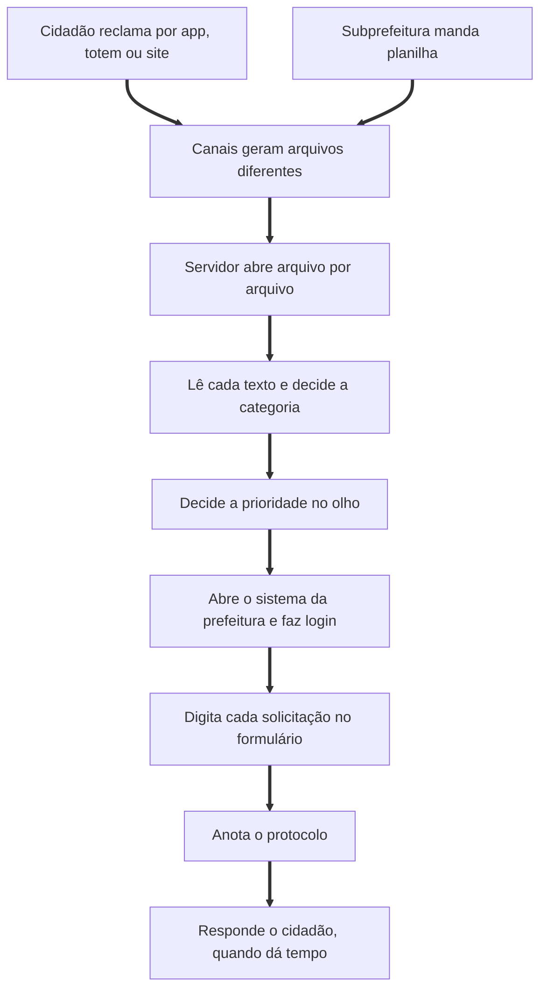
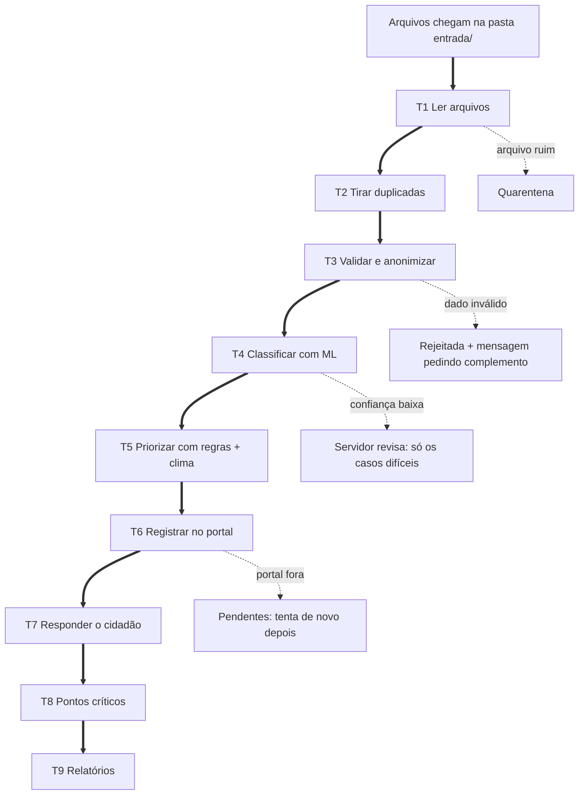

# Processo: AS-IS e TO-BE

Antes de escrever código, seguimos as etapas do BPM vistas em aula: **identificar → modelar → analisar → otimizar → automatizar → monitorar**. A frase que guiou o projeto foi "BPM otimiza o processo; RPA automatiza as tarefas".

## 1. Identificar

**Processo:** atender uma solicitação de zeladoria urbana, desde a reclamação do cidadão até o encaminhamento para o setor responsável com um protocolo.

**Quem participa:** o cidadão (abre a reclamação), o servidor da triagem (lê, classifica, prioriza e digita) e o setor responsável (executa o serviço).

## 2. Modelar o AS-IS (como funciona hoje, de forma simplificada)

## 3. Analisar (gargalos e desperdícios)

| Tarefa AS-IS | Problema | Tipo |
| :- | :- | :- |
| Abrir arquivos de vários canais | Encoding diferente, formato diferente, linha duplicada | Repetitiva, baseada em regra |
| Ler e categorizar | Lento; dois servidores podem classificar diferente | Repetitiva, mas precisa interpretar texto |
| Decidir prioridade | Sem critério escrito; caso perigoso pode ficar na fila comum | Baseada em regra (se a regra existir) |
| Digitar no sistema | Copiar e colar; erro de digitação | Repetitiva, baseada em regra |
| Responder o cidadão | Muitas vezes não acontece | Repetitiva |
| Casos estranhos ou fora do escopo | Exigem julgamento | **Não é para robô** |

A análise mostrou que quase tudo é repetitivo e baseado em regras (bom para RPA), menos dois pontos: **interpretar o texto livre** (que precisa de IA) e **os casos ambíguos** (que precisam de gente). Também ficou claro que faltava uma **regra explícita de prioridade**, então criamos uma.

## 4. Otimizar e desenhar o TO-BE

O que mudou do AS-IS para o TO-BE:

1. **Entrada unificada:** todos os canais caem numa pasta só, e o robô entende cada formato.
2. **Critério de prioridade escrito e explicável:** peso da categoria + palavras de risco + reincidência + previsão de chuva, sempre com justificativa.
3. **O servidor sai da digitação e vai para a revisão:** ele só olha o que o robô não teve certeza, com os urgentes no topo.
4. **Todo cidadão recebe resposta**, inclusive quem foi rejeitado (com o que faltou) e quem caiu em pendente.
5. **Nada se perde:** cada problema tem uma fila própria.

## 5. Automatizar: tarefas e relações no código

| Tarefa | Depende de | Arquivo | Se der errado |
| :- | :- | :- | :- |
| T1 Ler arquivos | arquivos na pasta | `leitura.py` | quarentena |
| T2 Tirar duplicadas | T1 | `pipeline.py` | ignora e conta |
| T3 Validar e anonimizar | T2 | `validacao.py` | rejeitadas |
| T4 Classificar | T3 (só dado válido) | `modelo.py` | revisão humana |
| T5 Priorizar | T4 (precisa da categoria) | `prioridade.py` | segue sem o critério de chuva |
| T6 Registrar | T5 (precisa da prioridade e do órgão) | `rpa_portal.py` | pendentes |
| T7 Responder cidadão | T3, T4 ou T6 (depende do status) | `pipeline.py` | (sempre gera) |
| T8 Pontos críticos | T6 (só registradas) | `modelo.py` | pula se tiver poucos dados |
| T9 Relatórios | todas | `relatorio.py` | se o Excel falhar, gera o JSON |

## 6. Monitorar

Cada execução gera indicadores (lidos, registrados, revisão humana, rejeitados, pendentes, tempo, memória) na aba Resumo da planilha e no JSON de execução. Na execução de exemplo o robô registrou 23 solicitações em cerca de 25 segundos, contando a subida do navegador e as consultas à API de clima. Não medimos o tempo do processo manual, então não fazemos comparação de ganho em números; o ganho que conseguimos afirmar é que a digitação deixou de existir e o servidor passou a olhar 4 casos em vez de 31.
