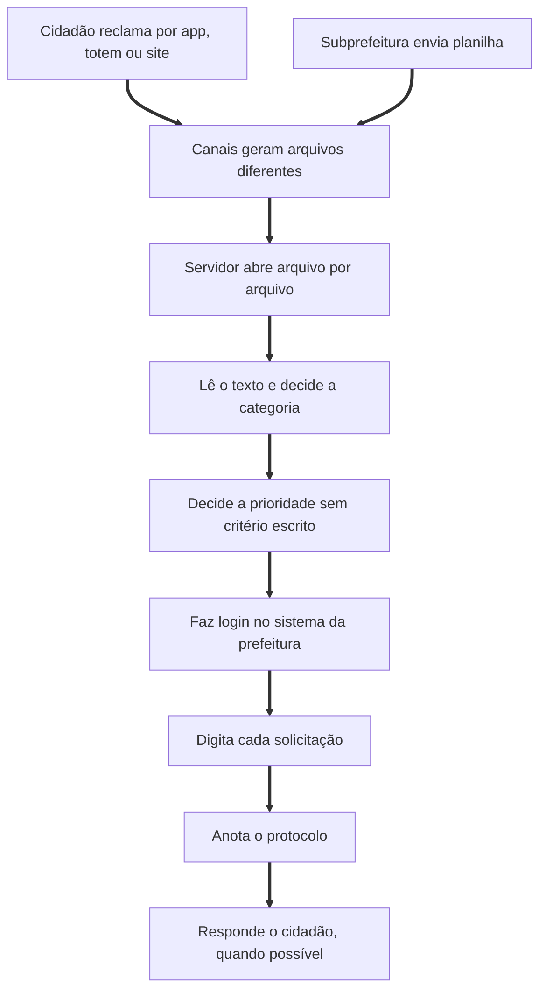
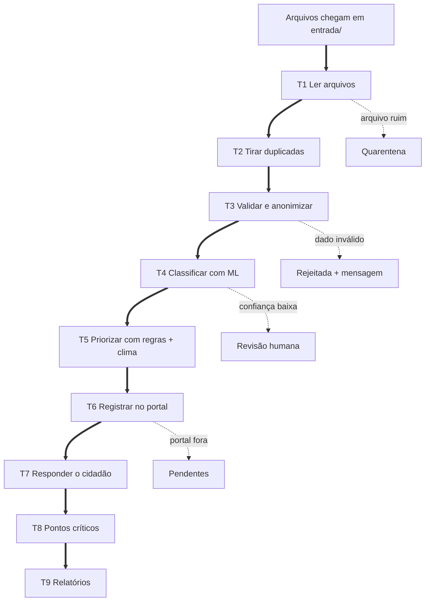

# Processo: AS-IS e TO-BE

Etapas do BPM: identificar → modelar → analisar → otimizar → automatizar → monitorar.

## 1. Identificar

**Processo:** atender uma solicitação de zeladoria, da reclamação ao encaminhamento com protocolo.
**Participantes:** cidadão, servidor da triagem e setor responsável pelo serviço.

## 2. AS-IS

## 3. Análise

| Tarefa | Problema | Tipo |
| :- | :- | :- |
| Abrir arquivos dos canais | Formatos, encodings e duplicatas | Repetitiva, baseada em regra |
| Categorizar | Lento e inconsistente entre servidores | Repetitiva, exige interpretar texto |
| Priorizar | Sem critério; risco pode ficar na fila comum | Baseada em regra, se ela existir |
| Digitar no sistema | Cópia manual e erros | Repetitiva, baseada em regra |
| Responder o cidadão | Frequentemente não ocorre | Repetitiva |
| Casos ambíguos | Exigem julgamento | Não automatizável |

Quase tudo é repetitivo e baseado em regras, exceto interpretar texto livre (IA) e decidir casos ambíguos (pessoas). Faltava também uma regra explícita de prioridade.

## 4. TO-BE

Mudanças:

1. **Entrada unificada** numa pasta, com leitura de todos os formatos.
2. **Prioridade explicável:** categoria + risco + reincidência + previsão de chuva, sempre com justificativa.
3. **Servidor na revisão, não na digitação:** só os casos incertos, com urgentes no topo.
4. **Todo cidadão recebe resposta,** inclusive rejeitados e pendentes.
5. **Nada se perde:** cada falha tem fila própria.

## 5. Automatizar: tarefas e relações

| Tarefa | Depende de | Arquivo | Em caso de falha |
| :- | :- | :- | :- |
| T1 Ler arquivos | pasta `entrada/` | `leitura.py` | quarentena |
| T2 Tirar duplicadas | T1 | `pipeline.py` | ignora e contabiliza |
| T3 Validar e anonimizar | T2 | `validacao.py` | rejeitadas |
| T4 Classificar | T3 | `modelo.py` | revisão humana |
| T5 Priorizar | T4 | `prioridade.py` | segue sem o critério de chuva |
| T6 Registrar | T5 | `rpa_portal.py` | pendentes |
| T7 Responder cidadão | T3, T4 ou T6 | `pipeline.py` | sempre gera |
| T8 Pontos críticos | T6 | `modelo.py` | pula com poucos dados |
| T9 Relatórios | todas | `relatorio.py` | JSON se o Excel falhar |

## 6. Monitorar

Cada execução registra lidos, registrados, revisões, rejeições, pendentes, tempo e memória na aba Resumo e no JSON de execução. Na execução de referência, 23 solicitações foram registradas em cerca de 25 segundos, e a atuação do servidor caiu de 31 casos para 4. O tempo do processo manual não foi medido, por isso não há comparação numérica de ganho.
